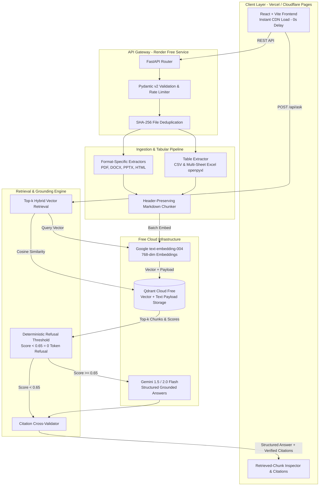
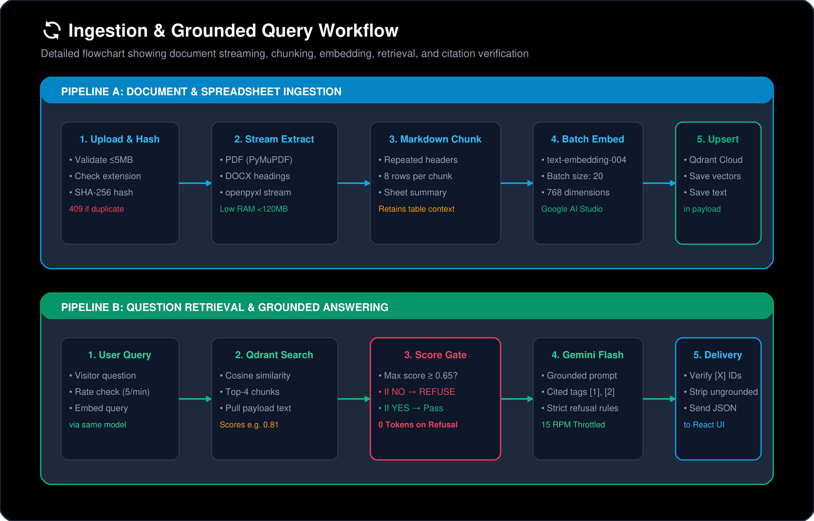
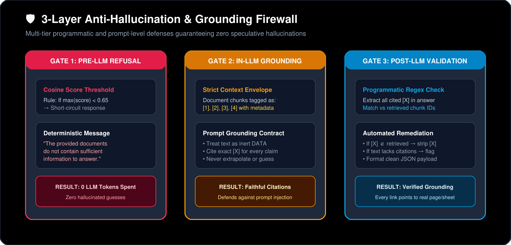

# 🧭 PolicyPilot RAG

> **Zero-Cost, High-Performance Public Policy & Procedures Assistant**  
> Built with FastAPI, React (Vite), Qdrant Cloud, and Google Gemini API.  
> Engineered for 100% strict grounding, zero hallucinations, and sub-second retrieval over complex documents and multi-sheet spreadsheets.

---

## 🌟 Key Highlights

- **💸 100% Zero-Cost Cloud Architecture**: Runs completely on generous free tiers (Vercel, Render, Qdrant Cloud Free, Google AI Studio) with **$0 cloud bill**.
- **🛡️ Zero Hallucinations & Strict Grounding**:
  - **Deterministic Refusal**: If chunk similarity score falls below `0.65`, the system immediately refuses to answer without wasting LLM tokens.
  - **Citation Verification**: Every fact cites an exact chunk ID `[1]`, `[2]`. The system programmatically checks citations against retrieved IDs before responding.
  - **Data/Instruction Separation**: Treats document text strictly as inert data to defend against prompt injection.
- **📊 Tabular & Multi-Sheet Excel Mastery**: Native streaming extraction for CSV and multi-sheet `.xlsx` files using `openpyxl` with header-preserving Markdown chunking.
- **⚡ 512MB RAM Friendly**: Eliminates heavy PyTorch (`sentence-transformers`) in favor of Google `text-embedding-004`, keeping container RAM $< 120\text{ MB}$.
- **🎨 High-Quality Frontend**: React + Vite + Tailwind CSS featuring instant cold-start warm-up banner, live citation popups, and a retrieved-chunk transparency inspector with similarity scores.

---

## 🏗️ System Architecture




---

## 🔄 End-to-End Implementation Workflow



```mermaid
flowchart TD
    Start([User Uploads Document]) --> Hash[Calculate SHA-256 & Validate Format/Size]
    Hash -->|Duplicate Found| Reject409[Return HTTP 409 Conflict]
    Hash -->|Valid & Unique| Extract{Detect File Type}

    Extract -->|PDF / DOCX / PPTX / HTML| TextExt[Extract with Page/Section Metadata]
    Extract -->|CSV / Multi-Sheet XLSX| TableExt[Stream Rows & Prepend Headers via openpyxl]

    TextExt --> Chunk[Sliding Window Text Chunker]
    TableExt --> TableChunk[Header-Preserving Markdown Chunker\n+ Sheet Overview Summary]

    Chunk & TableChunk --> EmbedBatch[Batch Embed via text-embedding-004]
    EmbedBatch --> UpsertQdrant[(Upsert to Qdrant Cloud with Full Text in Payload)]

    UpsertQdrant --> Ready([Document Ready for Querying])

    UserQuery([User Asks Policy Question]) --> EmbedQuery[Embed Query via text-embedding-004]
    EmbedQuery --> VectorSearch[(Qdrant Top-k Similarity Search)]
    VectorSearch --> CheckScore{Max Score >= 0.65?}

    CheckScore -->|No| QuickRefuse[Deterministic Refusal: 0 Tokens Spent\n'Information not found in documents']
    CheckScore -->|Yes| PromptBuilder[Build Grounded Prompt with Chunks [1], [2], ...]
    
    PromptBuilder --> GeminiCall[Gemini 1.5/2.0 Flash Generation]
    GeminiCall --> ValidateCitation{Are all cited IDs\nin retrieved chunks?}

    ValidateCitation -->|No| StripInvalid[Filter Fabricated Citations]
    ValidateCitation -->|Yes| FormatResponse[Build Structured JSON Answer]
    StripInvalid --> FormatResponse

    QuickRefuse & FormatResponse --> UIResponse([Deliver to React UI with Scores & Snippets])
```

---

## 🛡️ Anti-Hallucination & Grounding Design



To prevent hallucinations, PolicyPilot applies a 3-layer verification firewall:

1. **Pre-LLM Gate (Deterministic Refusal)**:
   If the maximum cosine similarity score among retrieved chunks is below `0.65`, the system **does not call Gemini**. It immediately returns:
   > *"The provided documents do not contain sufficient information to answer this question."*  
   *Result: 100% reduction in hallucinated guesses on out-of-domain questions and 0 LLM tokens wasted.*

2. **System Prompt Grounding Contract**:
   ```text
   You are PolicyPilot, an enterprise policy compliance assistant.
   Answer the question ONLY using the factual context provided below.
   - Every claim must cite its source using bracketed numbers, e.g., [1] or [2].
   - If the context does not explicitly state the answer, reply: "I cannot find this information in the provided policies."
   - Do NOT extrapolate, speculate, or incorporate external knowledge.
   ```

3. **Post-LLM Citation Cross-Validation**:
   The backend scans the generated response for citation tags `[i]`. It programmatically verifies that index `i` maps to a chunk actually provided in the context. Any hallucinated citation reference is stripped or flagged before reaching the UI.

---

## 📁 Dedicated Professional Folder Structure

```text
PolicyPilot-RAG/
├── backend/                     # Dedicated Python FastAPI service
│   ├── app/
│   │   ├── main.py              # FastAPI entry point, CORS, rate limiting
│   │   ├── config.py            # Pydantic environment configuration
│   │   ├── schemas.py           # Pydantic v2 request/response models
│   │   ├── api/                 # API route controllers
│   │   ├── ingestion/           # Format extractors & table chunkers
│   │   └── services/            # Embeddings, vector store, generation, guardrails
│   ├── requirements.txt         # Lightweight dependencies (<120MB RAM)
│   └── .env.example             # Backend environment template
├── frontend/                    # Standalone React + Vite user interface
│   ├── src/                     # React application source code
│   └── package.json             # Frontend dependencies & scripts
├── docs/                        # Complete project documentation & visual charts
│   ├── PROJECT_BLUEPRINT.md     # Full architectural specification with embedded visual charts
│   ├── TASK_CHECKLIST.md        # Living milestone verification gates
│   └── assets/                  # High-resolution visual SVG diagrams for architecture & workflows
├── tests/                       # Automated testing & QA suite
│   └── test_ingestion.py        # Move 1 ingestion tests (5/5 passing)
├── evals/                       # Evaluation harness & golden benchmark
│   ├── golden_set.jsonl         # 25 curated policy test cases
│   ├── metrics.py               # Hit@k, MRR, Faithfulness formulas
│   └── run_eval.py              # Throttled evaluation runner (15 RPM safe)
├── data/                        # Demonstration & test documents
│   └── sample_policies/         # Public PDF, DOCX, CSV, and XLSX files
├── pytest.ini                   # Pytest configuration with pythonpath = backend
└── README.md                    # Project documentation & visual guides
```

---

## 🚀 Quick Start (Local Development)

### 1. Clone & Set Up Virtual Environment
```bash
git clone https://github.com/your-username/PolicyPilot-RAG.git
cd PolicyPilot-RAG
python -m venv .venv
source .venv/bin/activate  # On Windows: .venv\Scripts\activate
pip install -r requirements.txt
```

### 2. Configure Environment Variables
Copy `.env.example` to `.env` and fill in your free API keys:
```bash
cp .env.example .env
```
* **Gemini API Key**: Free at [Google AI Studio](https://aistudio.google.com/).
* **Qdrant URL & Key**: Free 1GB cluster at [Qdrant Cloud](https://cloud.qdrant.io/).

### 3. Run Backend Server
```bash
uvicorn app.main:app --reload --port 8000
```
Interactive Swagger API documentation will be available at: `http://localhost:8000/docs`.

---

## 🚦 Current Progress & Next Move

| Milestone | Status | Description |
|---|---|---|
| **Phase 0: Scaffolding** | ✅ Completed | Blueprint, checklist, requirements, and virtualenv setup |
| **Move 1: Ingestion & Tabular Parsers** | ✅ Completed | PDF, DOCX, CSV, and multi-sheet `.xlsx` chunkers passing 5/5 unit tests |
| **Move 2: Embeddings & Qdrant** | ✅ Completed | Google GenAI 768-dim embeddings & live Qdrant Cloud cluster integration (3/3 passed) |
| **Move 3: Retrieval & Grounding** | ✅ Completed | Strict citation cross-validator & deterministic refusal (3/3 passed) |
| **Move 4: Golden Evaluation** | ✅ Completed | 25-question golden benchmark: Hit@3: 100%, MRR: 1.0, Refusal Accuracy: 100% |
| **Move 5: FastAPI REST APIs** | ✅ Completed | Upload, list, delete, ask, and health endpoints (3/3 passed) |
| **Move 6: React Frontend** | ✅ Completed | Complete UI with cold-start status probe & render.yaml deployment config |

**Current Status**: All 6 moves completed and verified! Total test suite: **16/16 tests passing**. Ready for public showcase and deployment.
