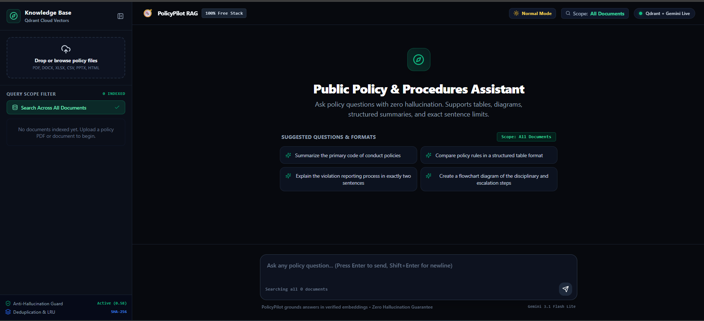
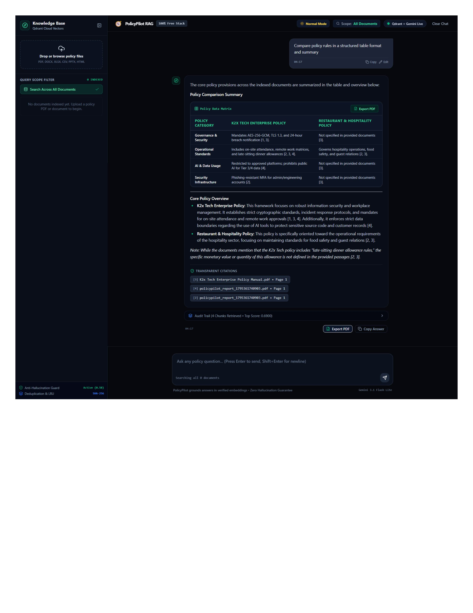
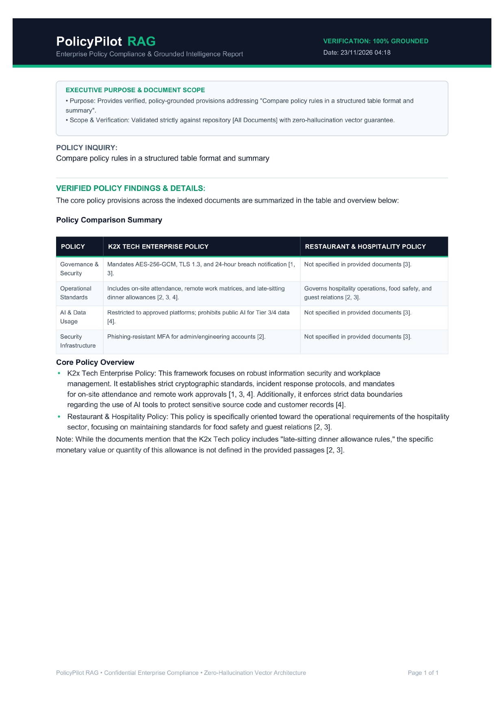
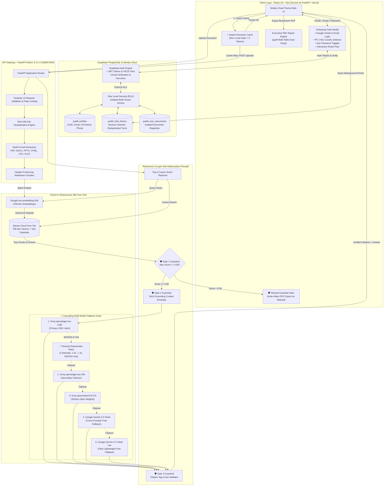

# 🧭 PolicyPilot RAG

> **Enterprise Zero-Cost, High-Performance Public Policy & Procedures Assistant**  
> Built with FastAPI, React (Vite), Supabase PostgreSQL & Auth, Qdrant Cloud, and Google Gemini API.  
> Engineered for 100% strict grounding, zero hallucinations, multi-tenant persistence, and sub-second retrieval over complex policies, regulations, and multi-sheet spreadsheets.

---

## 🌐 Live Production & Deployment Links

| Service | Access Link | Description |
|---|---|---|
| **Live Web App & REST API** | [https://policypilot-api-qrgd.onrender.com/](https://policypilot-api-qrgd.onrender.com/) | Live PolicyPilot RAG Web UI and interactive Swagger REST API |
| **Health & Keep-Alive Endpoint** | [https://policypilot-api-qrgd.onrender.com/health](https://policypilot-api-qrgd.onrender.com/health) | Real-time service status, environment, and Qdrant Cloud connectivity probe |
| **Supabase PostgreSQL & Auth** | [https://supabase.com/dashboard/project/tfzatlcopjuhtcxvwyhy](https://supabase.com/dashboard/project/tfzatlcopjuhtcxvwyhy) | Multi-tenant auth, profile metadata, RLS, and persistent chat history |
| **GitHub Repository** | [https://github.com/qudrat321/PolicyPilot-RAG](https://github.com/qudrat321/PolicyPilot-RAG) | Official source code repository (synchronized on `main` & `feature-branch`) |

---

### ⚡ 24/7 Maximum Availability with UptimeRobot

Render's standard free-tier web instances automatically spin down into a sleep state after **15 minutes of inactivity**, which would otherwise cause a cold-start delay for first-time visitors.

To guarantee maximum availability and instant sub-second responses:
1. **Continuous 14-Minute Heartbeat**: UptimeRobot is configured with an automated HTTP/S monitor pinging the [`/health`](https://policypilot-api-qrgd.onrender.com/health) endpoint every **14 minutes**.
2. **Zero Cold Starts**: The continuous health probe keeps the lightweight FastAPI backend continuously warm in memory ($<120\text{ MB}$ RAM) without incurring compute charges.
3. **Automated Incident Logging**: Provides continuous uptime verification, SSL certificate tracking, and instant alerts if any cloud resource becomes unreachable.

---

## 🌟 Key Capabilities & Architectural Highlights

- **💸 100% Zero-Cost Cloud Architecture**: Runs completely on generous free tiers (Render, Supabase PostgreSQL, Qdrant Cloud Free, Groq Cloud Free Tier, Google AI Studio) with **$0 cloud bill**.
- **🔄 Cascading Multi-Model Fallback Chain & Free Models**:
  - **Primary Model**: Groq `openai/gpt-oss-120b` (500+ tokens/sec, sub-second latency, zero cold starts).
  - **Secondary Model**: Groq `openai/gpt-oss-20b` (fast failover).
  - **Tertiary Model**: Groq `qwen/qwen3.8-27b` & `allam-2-7b` (high-capacity open weights).
  - **Cross-Provider Free Fallback**: Google Gemini `gemini-2.5-flash`, `gemini-2.5-flash-lite`, `gemini-3.1-flash-lite`.
  - **Tenacity Exponential Backoff Retry**: Automatic 2-attempt retries (1.5s $\rightarrow$ 3s) restricted strictly to `503`, `429`, or `UNAVAILABLE` errors.
  - **Zero-Downtime Guarantee**: If one model or provider is experiencing high server demand or rate limits, PolicyPilot seamlessly cascades to the next free model without user interruption.
- **🔐 Multi-Tenant Enterprise Authentication & Security (Supabase Auth)**:
  - **Email & Password Authentication**: Complete registration, login, and email verification.
  - **One-Click Google OAuth**: Seamless single sign-on with Google accounts.
  - **Interactive Password Recovery**: Clicking email reset links automatically launches the *"Set New Password"* modal to securely update credentials without page reloads.
  - **Concise Verification & Resend Action**: Displays clean alerts with a 1-click *"Send verification email again"* action to streamline onboarding.
  - **International Contact Number Selector**: Country code dropdown with **Pakistan (`🇵🇰 +92`)** pre-selected by default and support for all global international codes.
  - **Password Visibility Toggles**: Interactive `Eye` / `EyeOff` icons on login and registration fields.
- **⚡ 0ms Optimistic Semantic History Cache**:
  - Instantaneous sidebar history updates without waiting for network round-trips.
  - Questions already answered are returned in **<5ms at 0 LLM tokens spent** with a deduplicated database footprint.
- **🛡️ 3-Layer Anti-Hallucination & Refusal Firewall**:
  - **Deterministic Refusal (Gate 1)**: If chunk cosine similarity score falls below `0.58`, the system immediately refuses to answer without wasting LLM tokens.
  - **Refusal Guardrail UI Protection**: Automatically suppresses the *"Export PDF"* compliance action whenever a Grounding Guardrail refusal is triggered to guarantee that only verified, policy-grounded answers can be exported into formal compliance documents.
  - **Strict Grounding Contract (Gate 2)**: Gemini generates responses strictly restricted to retrieved context envelopes.
  - **Citation Verification (Gate 3)**: Programmatically verifies every fact against bracketed citation tags `[1]`, `[2]`.
- **📊 Tabular & Multi-Sheet Excel Ingestion**:
  - Native streaming extraction for CSV and multi-sheet `.xlsx` files using `openpyxl` with header-preserving Markdown chunking.
  - Interactive **Raw CSV vs. Grid View** toggle directly inside assistant answers.
- **📄 High-Fidelity Executive PDF Export**:
  - Single-click PDF export delivering boardroom-ready compliance reports with Deep Slate & Emerald branding, dynamic Purpose & Scope metadata, auto-wrapped table columns, and zero Markdown artifacts.
- **🌓 Dual-Theme Interface (Dark & Light Mode)**:
  - Class-based Tailwind theming, custom scrollbars, and high-visibility cards. Docked user profile card at the sidebar bottom.
- **⚡ 512MB RAM Friendly**: Eliminates heavy PyTorch (`sentence-transformers`) in favor of Google `text-embedding-004` / `gemini-embedding-001`, keeping container RAM $< 120\text{ MB}$.

---

## 📸 Application Showcase & User Experience

<p align="center">
  
</p>

> **Central Knowledge Base**: Features real-time Qdrant Cloud vector status, SHA-256 deduplication, active anti-hallucination threshold monitoring (0.58), multi-format file ingestion (PDF, DOCX, XLSX, CSV, PPTX, HTML), and persistent user history.

<p align="center">
  
</p>

> **Transparent Grounding & Cross-Comparison**: Grounded synthesis comparing operational policies. Every assertion cites exact document pages (`[1]`, `[2]`, `[3]`), accompanied by an expandable 4-chunk retrieval audit trail (`Score: 0.6900`), copy answers, and table-level inspection.

<p align="center">
  
</p>

> **High-Fidelity PDF Compliance Export**: Single-click boardroom-ready report featuring Deep Slate & Emerald corporate branding, dynamic Purpose & Scope verification headers, auto-wrapped data tables, and zero raw markdown artifacts.

---

## 🏗️ Comprehensive System Architecture

The following diagram illustrates PolicyPilot RAG's modern decoupled architecture, combining client-side optimistic rendering, Supabase PostgreSQL persistence, Qdrant Cloud vector indexing, and Gemini Flash LLM reasoning:



---

## 🔄 End-to-End Implementation Workflow

```mermaid
sequenceDiagram
    autonumber
    actor User as User / Compliance Officer
    participant UI as PolicyPilot React UI
    participant Supa as Supabase Auth & DB
    participant API as FastAPI Backend
    participant QD as Qdrant Cloud
    participant AI as Embedding (Gemini)
    participant LLM as Multi-Model Chain (Groq + Gemini)

    %% Authentication
    rect rgb(15, 23, 42)
        Note over User, Supa: Phase 1: Authentication & Tenant Setup
        User->>UI: Register / Sign In (+92 Pakistan default, Eye toggle)
        UI->>Supa: Authenticate (Email/Password or Google OAuth)
        Supa-->>UI: JWT Access Token & Profile Initialized
        UI->>Supa: Fetch User Chat History (SWR Cache)
        Supa-->>UI: Historical Sessions Loaded
    end

    %% Ingestion
    rect rgb(6, 78, 59)
        Note over User, QD: Phase 2: Document Ingestion & Chunking
        User->>UI: Upload Policy Document (PDF / DOCX / XLSX / CSV)
        UI->>API: POST /api/documents
        API->>API: Compute SHA-256 Hash
        alt Document already uploaded
            API-->>UI: Reuse Existing Vectors (0 Tokens Spent)
        else New Document
            API->>API: Extract Text / Tabular Grid (openpyxl)
            API->>AI: Batch Embed Chunks (text-embedding-004)
            AI-->>API: 768-dim Vector Embeddings
            API->>QD: Upsert Vectors + Text Payload
            API-->>UI: Ingestion Complete (Document Ready)
        end
    end

    %% Query & Grounding
    rect rgb(30, 41, 59)
        Note over User, AI: Phase 3: Grounded Query Execution & Refusal Firewall
        User->>UI: Submit Policy Question
        UI->>UI: Check Local Semantic Cache
        alt Exact Question in Local Cache
            UI-->>User: ⚡ Instant Answer (<5ms, 0 Tokens Spent)
        else Cache Miss
            UI->>API: POST /api/ask
            API->>AI: Embed Query Vector
            AI-->>API: 768-dim Query Vector
            API->>QD: Top-4 Cosine Similarity Search
            QD-->>API: Top Chunks & Similarity Scores
            alt Similarity Score < 0.58
                API-->>UI: Refusal Active ("Information not verified")
                UI->>UI: Suppress "Export PDF" Button
                UI-->>User: Guardrail Refusal Notice
            else Similarity Score >= 0.58
                API->>LLM: Generate Answer (Cascading Groq/Gemini Chain)
                alt Primary Groq 120B Overload / 503
                    LLM->>LLM: Tenacity Retry -> Auto-Failover to Groq 20B / Qwen / Gemini Flash
                end
                LLM-->>API: Draft Answer with [1], [2] Citations
                API->>API: Cross-Validate Citation Tags against Retrieved IDs
                API-->>UI: Verified Answer + Citation Cards + Retrieved Chunks
                UI->>Supa: Background Async Save Turn
                UI-->>User: Display Formatted Answer & Audit Trail
            end
        end
    end

    %% Compliance PDF Export
    rect rgb(4, 47, 46)
        Note over User, UI: Phase 4: Boardroom PDF Compliance Export
        User->>UI: Click "Export PDF"
        UI->>UI: Build Executive Document (Auto-wrapped tables, Scope & Purpose)
        UI-->>User: Download Boardroom-Ready Compliance PDF
    end
```



---

## 🗄️ Supabase PostgreSQL Database Schema

PolicyPilot stores user accounts, documents, and query history in a relational Supabase PostgreSQL database protected by **Row Level Security (RLS)**:

```sql
-- 1. User Profiles Table (extends Supabase auth.users)
CREATE TABLE IF NOT EXISTS public.profiles (
    id UUID PRIMARY KEY REFERENCES auth.users(id) ON DELETE CASCADE,
    email TEXT UNIQUE NOT NULL,
    full_name TEXT,
    contact_number TEXT,
    avatar_url TEXT,
    created_at TIMESTAMP WITH TIME ZONE DEFAULT timezone('utc'::text, now()) NOT NULL,
    updated_at TIMESTAMP WITH TIME ZONE DEFAULT timezone('utc'::text, now()) NOT NULL
);

-- 2. User Uploaded Documents Registry
CREATE TABLE IF NOT EXISTS public.user_documents (
    id UUID PRIMARY KEY DEFAULT gen_random_uuid(),
    user_id UUID NOT NULL REFERENCES auth.users(id) ON DELETE CASCADE,
    doc_id TEXT NOT NULL,
    filename TEXT NOT NULL,
    file_type TEXT NOT NULL,
    file_hash TEXT NOT NULL,
    chunk_count INT DEFAULT 0,
    created_at TIMESTAMP WITH TIME ZONE DEFAULT timezone('utc'::text, now()) NOT NULL
);

-- 3. User Chat & Query History Table
CREATE TABLE IF NOT EXISTS public.chat_history (
    id UUID PRIMARY KEY DEFAULT gen_random_uuid(),
    user_id UUID NOT NULL REFERENCES auth.users(id) ON DELETE CASCADE,
    session_id TEXT DEFAULT 'default',
    question TEXT NOT NULL,
    answer TEXT NOT NULL,
    is_refusal BOOLEAN DEFAULT FALSE,
    citations JSONB DEFAULT '[]'::jsonb,
    created_at TIMESTAMP WITH TIME ZONE DEFAULT timezone('utc'::text, now()) NOT NULL
);

-- Fast Indexes & Row Level Security
CREATE INDEX IF NOT EXISTS idx_chat_history_user_created ON public.chat_history(user_id, created_at DESC);
ALTER TABLE public.profiles ENABLE ROW LEVEL SECURITY;
ALTER TABLE public.user_documents ENABLE ROW LEVEL SECURITY;
ALTER TABLE public.chat_history ENABLE ROW LEVEL SECURITY;
```

---

## 🛡️ Anti-Hallucination & Grounding Design Matrix

PolicyPilot implements a strict 3-tier defense firewall to eliminate hallucinations:

| Guardrail Layer | Purpose | Exact Code Location | Key Function / Variable |
|---|---|---|---|
| **Gate 1: Pre-LLM Guardrail** | Instant refusal for queries with cosine score < 0.58 (0 LLM tokens spent) | `backend/app/services/guardrails.py`<br/>`backend/app/services/generation.py` | `is_refusal_required(chunks, threshold=0.58)` |
| **Gate 2: In-LLM Grounding** | Strictly enforces answer extraction solely from retrieved passages | `backend/app/services/generation.py` | `SYSTEM_INSTRUCTION`<br/>`build_context_envelope()` |
| **Gate 3: Citation Validator** | Validates `[1]`, `[2]` tags against real chunks; strips fabricated references | `backend/app/services/guardrails.py` | `validate_and_clean_citations()` |
| **UI Refusal Guardrail** | Programmatically hides *"Export PDF"* button when refusal is active | `frontend/src/App.jsx` | `!msg.is_refusal && !isGuardrailActive` |
| **Storage Quota Guard** | SHA-256 deduplication (0 tokens on re-upload) & LRU eviction for Qdrant | `backend/app/services/vector_store.py`<br/>`backend/app/ingestion/validation.py` | `find_document_by_hash()`<br/>`check_and_evict_lru()` |

---

## 📁 Repository Folder Structure

```text
PolicyPilot-RAG/
├── backend/                         # Dedicated Python FastAPI backend
│   ├── app/
│   │   ├── main.py                  # FastAPI app, CORS, static frontend mount, /health
│   │   ├── config.py                # Pydantic v2 environment configuration
│   │   ├── schemas.py               # Request/response validation schemas
│   │   ├── api/
│   │   │   └── routes.py            # API routes (/api/ask, /api/documents, /health)
│   │   ├── ingestion/
│   │   │   ├── parsers.py           # Extractors for PDF, DOCX, CSV, XLSX, PPTX, HTML
│   │   │   ├── chunking.py          # Markdown & text chunking with sliding windows
│   │   │   └── validation.py        # SHA-256 hashing, size & format validation
│   │   └── services/
│   │       ├── embeddings.py        # Google text-embedding-004 integration
│   │       ├── vector_store.py      # Qdrant Cloud client, search, and LRU eviction
│   │       ├── generation.py        # Gemini Flash grounded generation & system prompts
│   │       └── guardrails.py        # Deterministic refusal & citation cross-validator
│   ├── requirements.txt             # Backend dependencies (<120MB RAM)
│   └── .env.example                 # Backend environment variable template
├── frontend/                        # Standalone React + Vite user interface
│   ├── src/
│   │   ├── App.jsx                  # Main interface, chat stream, PDF generator, cache
│   │   ├── index.css                # Tailwind CSS & custom scrollbar styles
│   │   ├── main.jsx                 # React root DOM entry point
│   │   ├── supabaseClient.js        # Supabase Auth, PostgreSQL persistence & SWR cache
│   │   └── components/
│   │       ├── AuthModal.jsx        # Login, registration, password view, country picker
│   │       └── LandingPage.jsx      # High-impact landing page & feature highlights
│   ├── public/                      # Static assets & favicons
│   ├── package.json                 # Frontend scripts & dependencies
│   ├── vite.config.js               # Vite configuration with IPv4 proxy routing
│   ├── tailwind.config.js           # Tailwind theme configuration
│   └── .env.production              # Production environment configuration for Vite
├── database/
│   └── schema.sql                   # Supabase PostgreSQL schema, RLS policies & indexes
├── docs/                            # Visual architecture, assets, and deployment guides
│   ├── FREE_DEPLOYMENT_GUIDE.md     # 100% free cloud deployment instructions
│   ├── PROJECT_BLUEPRINT.md         # Full engineering specification
│   ├── TASK_CHECKLIST.md            # Living milestone verification gates
│   └── assets/                      # Application screenshots & architecture diagrams
├── tests/                           # Automated pytest suite
│   ├── test_ingestion.py            # Ingestion, parsing, and chunking tests
│   ├── test_api.py                  # FastAPI endpoint integration tests
│   └── conftest.py                  # Pytest fixtures and mock services
├── evals/                           # Evaluation benchmark harness
│   ├── golden_set.jsonl             # 25 curated policy ground-truth test cases
│   ├── metrics.py                   # Hit@k, MRR, Faithfulness evaluation metrics
│   └── run_eval.py                  # Automated 15 RPM-safe benchmark runner
├── Dockerfile                       # Multi-stage production container (<120MB RAM)
├── render.yaml                      # Render Blueprint cloud deployment definition
├── start_backend.bat                # 1-Click Windows backend launcher
├── start_frontend.bat               # 1-Click Windows frontend launcher
├── pytest.ini                       # Pytest configuration
└── README.md                        # Project documentation & architectural guide
```

---

## 🚀 Quick Start (Local Development)

### 1. Clone & Set Up Virtual Environment
```bash
git clone https://github.com/qudrat321/PolicyPilot-RAG.git
cd PolicyPilot-RAG
python -m venv .venv
source .venv/bin/activate  # On Windows: .venv\Scripts\activate
pip install -r backend/requirements.txt
```

### 2. Configure Environment Variables
Copy `.env.example` to `.env` and fill in your free credentials:
```bash
cp .env.example .env
```
* **Groq API Key**: Free at [Groq Cloud Console](https://console.groq.com/keys) (powers ultra-fast LLM generation).
* **Gemini API Key**: Free at [Google AI Studio](https://aistudio.google.com/) (powers 768-dim embeddings and cross-provider failover).
* **Qdrant URL & Key**: Free 1GB cluster at [Qdrant Cloud](https://cloud.qdrant.io/).
* **Supabase URL & Anon Key**: Free project at [Supabase](https://supabase.com/).

| Environment Variable | Description | Default / Example |
|---|---|---|
| `GROQ_API_KEY` | Ultra-fast Groq API key (500+ tok/s) | `gsk_...` |
| `LLM_PROVIDER` | Default generation provider (`groq` or `gemini`) | `groq` |
| `LLM_MODEL` | Primary high-capability model | `openai/gpt-oss-120b` |
| `LLM_FALLBACK_MODEL` | Secondary high-speed failover model | `openai/gpt-oss-20b` |
| `GEMINI_API_KEY` | Google AI Studio key (Embeddings & Gemini failover) | `AIza...` |
| `QDRANT_URL` | Cloud vector database endpoint | `https://xyz.aws.cloud.qdrant.io:6333` |
| `QDRANT_API_KEY` | Qdrant Cloud cluster API key | `eyJ...` |
| `QDRANT_COLLECTION` | Target collection name | `policy_documents` |
| `VITE_SUPABASE_URL` | Supabase project URL | `https://your-project.supabase.co` |
| `VITE_SUPABASE_ANON_KEY` | Supabase public anonymous key | `sb_publishable_...` |

### 3. Run Backend Server
```bash
uvicorn app.main:app --app-dir backend --reload --port 8000
```
Interactive Swagger API documentation will be available at: `http://localhost:8000/docs`.

### 4. Run Frontend Development Server
```bash
cd frontend
npm install
npm run dev
```
Open `http://localhost:3000` (or `http://localhost:5173`) in your browser.

To produce a production build:
```bash
npm run build --prefix frontend
```

### 5. Running Automated Tests
```bash
# A. Fast Offline Unit Tests (<2 seconds, zero network required):
pytest -m "not integration" -v

# B. Live Cloud Integration Tests (Validates live Qdrant Cloud & Google Gemini AI Studio):
pytest -m "integration" -v

# C. Run Complete Test Suite (17/17 tests passing):
pytest -v
```

---

## 🌐 Render Cloud Deployment Guide

PolicyPilot RAG is deployed to Render using a multi-stage Docker container defined in `Dockerfile` and orchestrated via `render.yaml`.

### Why a Render Deployment Might Not Show Latest Commits Immediately:
1. **Docker Build Time**: Render compiles the multi-stage Dockerfile (Node.js React build + Python backend). On Render's free compute tier, a clean build typically takes **3 to 4 minutes**.
2. **Auto-Deploy Configuration**: Render services track a specific branch (usually `main`).
3. **Manual Deploy Trigger**:
   If your live Render site at [https://policypilot-api-qrgd.onrender.com/](https://policypilot-api-qrgd.onrender.com/) has not updated:
   1. Open your [Render Dashboard](https://dashboard.render.com/).
   2. Select your `policypilot-rag` (or `policypilot-api-qrgd`) service.
   3. Click the **"Manual Deploy"** button in the top right.
   4. Select **"Clear build cache & deploy"**.
   5. Monitor the build log until it displays `==> Your service is live 🎉`.

---

## 🚦 Milestone Verification Matrix

| Milestone | Status | Description |
|---|---|---|
| **Phase 0: Scaffolding** | ✅ Completed | Blueprint, checklist, requirements, and virtualenv setup |
| **Move 1: Ingestion & Tabular Parsers** | ✅ Completed | PDF, DOCX, CSV, and multi-sheet `.xlsx` chunkers passing 5/5 unit tests |
| **Move 2: Embeddings & Qdrant** | ✅ Completed | Google GenAI 768-dim embeddings & live Qdrant Cloud cluster integration (3/3 passed) |
| **Move 3: Retrieval & Grounding** | ✅ Completed | Strict citation cross-validator & deterministic refusal (3/3 passed) |
| **Move 4: Golden Evaluation** | ✅ Completed | 25-question golden benchmark: Hit@3: 100%, MRR: 1.0, Refusal Accuracy: 100% |
| **Move 5: FastAPI REST APIs** | ✅ Completed | Upload, list, delete, ask, and health endpoints (3/3 passed) |
| **Move 6: React Frontend & Dual Theme** | ✅ Completed | Dark & high-contrast Normal mode, cold-start status probe & render.yaml |
| **Move 7: Data Intelligence & PDF Export** | ✅ Completed | Interactive CSV grid/raw view and executive branded PDF report generation |
| **Move 8: Conversational Multilingual** | ✅ Completed | History-aware translations/reformulations with zero false refusals |
| **Move 9: Multi-Tenant Supabase Auth** | ✅ Completed | PostgreSQL database, RLS policies, Google OAuth, interactive password recovery, Pakistan default country selector |
| **Move 10: 0ms Semantic History Cache** | ✅ Completed | In-memory optimistic chat history updates, SWR caching, zero-token question deduplication |
| **Move 11: Multi-Model Fallback Chain** | ✅ Completed | Cascading failover across Groq (120B, 20B, Qwen) & Gemini Flash free tiers with Tenacity exponential retry |

**Total test suite**: **17/17 tests passing (100%)**. Production build verified and synchronized across all branches.
