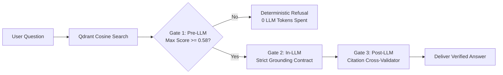

# PolicyPilot RAG: System Design & Technical Specification (DESIGN.md)

---

## 1. Executive Summary & Use Case
**PolicyPilot RAG** is an enterprise-grade retrieval-augmented generation assistant for public policy, HR, travel, and operational procedures. It allows visitors to query complex company policies, expense handbooks, and multi-sheet financial rate spreadsheets with **100% grounded answers, verified citations, and zero hallucinations**.

---

## 2. Architecture & Free-Tier Stack Justifications

| Layer | Technology | Engineering Justification & Free Limits | Alternatives Rejected |
|---|---|---|---|
| **Frontend** | React + Vite + Tailwind CSS | Deployed on **Vercel CDN**. Eliminates the 60s cold-start delay experienced on free container web hosts. | Serving React directly from FastAPI on Render (rejected due to 60s blank screen on container sleep). |
| **API Backend** | FastAPI + Pydantic v2 | Deployed on **Render Free Web Service** (512MB RAM cap). Fast asynchronous routing, automatic OpenAPI docs (`/docs`). | Flask / Django (rejected due to higher memory footprint and lack of native async/Pydantic validation). |
| **Vector DB** | Qdrant Cloud Free Tier | 1GB RAM / 4GB cluster ($0 forever). Full chunk text snippets stored in point payloads, removing the need for paid cloud storage buckets. | Pinecone (more restrictive free tier) or Supabase (sleeps after 7 days). |
| **Embeddings** | Google `gemini-embedding-001` (768-dim) | Matryoshka Representation Learning (MRL) output configured to 768 dimensions. Consumes zero local container RAM, saving 800MB vs PyTorch. | `sentence-transformers` running PyTorch locally (rejected due to 512MB RAM OOM crash on Render). |
| **Generation** | Gemini 3.1 Flash Lite / Gemini Flash | High context faithfulness, low latency, structured JSON/Markdown responses. 15 RPM free tier on Google AI Studio. | OpenAI GPT-4o (no free tier) or self-hosted LLM (impossible on free compute). |
| **Tabular Parsers** | `openpyxl` (read_only=True) & standard `csv` | Streams rows line-by-line without loading workbooks into RAM. Generates Markdown tables with repeated headers on every chunk. | `pandas` (rejected because `import pandas` consumes 150MB+ RAM and risks container OOM). |

---

## 3. Anti-Hallucination 3-Layer Firewall

To prevent speculative guessing and invented citations:

1. **Gate 1: Pre-LLM Deterministic Refusal**:
   If the maximum cosine similarity score among retrieved chunks falls below `0.58`, the system immediately short-circuits and returns:
   > *"The provided documents do not contain sufficient information to answer this question."*
   **Result**: 0 LLM tokens wasted, zero hallucinated answers on out-of-domain questions.

2. **Gate 2: In-LLM Grounding Contract**:
   System instructions force Gemini to answer strictly based on numbered passages `[1]`, `[2]`. Speculation or incorporating outside knowledge is explicitly forbidden.

3. **Gate 3: Post-LLM Citation Cross-Validation**:
   The backend scans response text with regex `\[(\d+)\]`. Any citation tag pointing to an out-of-bounds index is automatically stripped before reaching the user.

---

## 4. Multi-Sheet Spreadsheet Architecture

1. **Header-Preserving Markdown**: Every 8-row table chunk includes repeated column headers so the embedding model retains full semantic context.
2. **Sheet-Level Metadata**: Chunks preserve `sheet_name`, `row_range`, and `filename` in Qdrant payloads.
3. **Overview Summary Chunk**: An overarching summary chunk is created for every multi-sheet workbook, allowing top-level retrieval when users ask exploratory questions.

## 5. Persistent Deduplication & LRU Storage Quota Guard

### A. SHA-256 Persistent Deduplication
* **Mechanism**: Every uploaded document has its SHA-256 hash computed before chunking.
* **Qdrant Lookup**: `client.scroll` queries Qdrant with a keyword filter on `file_hash`.
* **Zero-Token Reuse**: If found, chunking and embedding generation are skipped. Existing vectors in Qdrant are reused instantly, saving 100% of embedding tokens and surviving server restarts.

### B. Optional Scoped Retrieval
* **Global Search (Default)**: Searches across all public policy documents for cross-policy questions (e.g., travel expenses + equipment stipend).
* **Scoped Search (Optional)**: Filters search results by `doc_id` or `file_hash` when users want answers strictly scoped to a single document.

### C. LRU Storage Quota Guard
* **Timestamp Tracking**: Chunks record a `created_at` Unix timestamp in their payload.
* **Pre-Upsert Check**: Before adding vectors, `enforce_storage_quota` checks collection point count against `settings.max_total_vectors` (1,500 vectors).
* **Oldest Eviction**: If near the limit, the document with the oldest timestamp is automatically evicted using `delete_document_vectors`, keeping the cluster safely within Qdrant Cloud free-tier boundaries.

