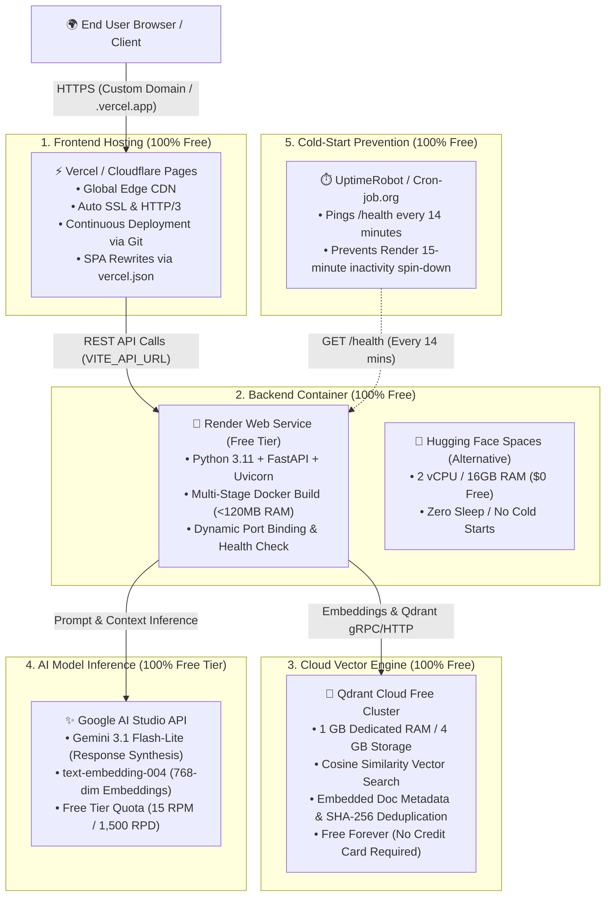

# PolicyPilot RAG - 100% Free ($0/Month) Cloud Deployment Guide

This guide provides the complete, production-tested architecture and step-by-step instructions to host the entire **PolicyPilot RAG** application online **100% free forever ($0/month)** using reliable, no-credit-card cloud platforms.

---

## 1. Zero-Cost Cloud Architecture Overview



---

## 2. Platform Comparison & Cost Breakdown

| Component | Platform | Free Tier Specifications | Credit Card Required? | Sleep Behavior |
| :--- | :--- | :--- | :--- | :--- |
| **Frontend** | **Vercel** or **Cloudflare Pages** | Unlimited bandwidth, 100 GB/mo edge traffic, 100 builds/day | **NO** | Instant (Global CDN, never sleeps) |
| **Backend** | **Render** | 512 MB RAM, 0.1 vCPU, 750 free compute hours/month | **NO** | Sleeps after 15 min inactivity *(prevented by ping)* |
| **Backend (Alt)**| **Hugging Face Spaces** | 2 vCPU, 16 GB RAM, Docker SDK container | **NO** | **Never sleeps** (Public spaces stay awake 24/7) |
| **Vector DB** | **Qdrant Cloud** | 1 Cluster (1 GB RAM, 4 GB SSD, up to 1M vectors) | **NO** | High availability, never sleeps |
| **Embeddings & LLM**| **Google AI Studio** | 15 RPM for Gemini Flash, 100 RPM for text-embedding-004 | **NO** | Managed serverless API |
| **Keep-Alive** | **UptimeRobot** | 50 free monitors, 5-minute ping intervals | **NO** | Runs in background 24/7 |
| **TOTAL** | — | **Full-featured Enterprise RAG stack** | **$0.00 / month** | **Always active & responsive** |

> [!NOTE]
> **Do we need a separate SQL database?**
> No. PolicyPilot RAG stores document metadata, page numbers, chunks, and SHA-256 deduplication hashes directly in **Qdrant vector payloads**. This eliminates the maintenance, cost, and connection pooling issues of an external database. If you later add multi-tenant user authentication, you can attach **Supabase** or **Neon** (both provide free-tier PostgreSQL without a credit card).

---

## 3. Two Deployment Topologies Available

### Topology A: Split Microservices (Recommended for Production)
* **Frontend:** Hosted on **Vercel** (`https://policypilot.vercel.app`).
* **Backend:** Hosted on **Render** (`https://policypilot-api.onrender.com`).
* **Advantages:** Blazing-fast frontend load times via global edge caching, independent CI/CD deployments.

### Topology B: Unified All-in-One Container (Easiest 1-Click Setup)
* **Single Container:** The provided `Dockerfile` builds the React frontend in Stage 1 and copies it into FastAPI's `frontend/dist`. FastAPI serves both the REST API and the static React SPA from a single Render or Hugging Face Space URL.
* **Advantages:** Single URL, zero CORS configuration needed, one repository deploy.

---

## 4. Production Configuration Files Included in the Repo

### File 1: `Dockerfile` (Low-Memory Multi-Stage Container)
Optimized for 512 MB RAM constraints with a single Uvicorn worker and headless Python runtime (<120 MB RAM footprint):
```dockerfile
# Stage 1: Build React Frontend
FROM node:20-alpine AS frontend-builder
WORKDIR /build
COPY frontend/package*.json ./
RUN npm ci
COPY frontend/ ./
RUN npm run build

# Stage 2: Ultra-lightweight Python Backend
FROM python:3.11-slim
WORKDIR /app
ENV PYTHONDONTWRITEBYTECODE=1 PYTHONUNBUFFERED=1 PORT=8000
RUN apt-get update && apt-get install -y --no-install-recommends curl && rm -rf /var/lib/apt/lists/*
COPY backend/requirements.txt ./backend/requirements.txt
RUN pip install --no-cache-dir -r ./backend/requirements.txt
COPY backend/ ./backend/
COPY --from=frontend-builder /build/dist ./frontend/dist
EXPOSE 8000 7860
HEALTHCHECK --interval=30s --timeout=5s --start-period=10s --retries=3 \
    CMD curl -f http://localhost:${PORT:-8000}/health || exit 1
CMD ["sh", "-c", "uvicorn app.main:app --host 0.0.0.0 --port ${PORT:-8000} --workers 1 --app-dir backend"]
```

### File 2: `render.yaml` (Render Blueprint Infrastructure-as-Code)
Allows 1-click declarative provisioning on Render:
```yaml
services:
  - type: web
    name: policypilot-rag
    env: docker
    dockerfilePath: Dockerfile
    plan: free
    region: oregon
    healthCheckPath: /health
    envVars:
      - key: GEMINI_API_KEY
        sync: false
      - key: QDRANT_URL
        sync: false
      - key: QDRANT_API_KEY
        sync: false
      - key: QDRANT_COLLECTION
        value: policy_documents
      - key: ENVIRONMENT
        value: production
      - key: CORS_ORIGINS
        value: "*"
      - key: SIMILARITY_THRESHOLD
        value: 0.58
      - key: TOP_K_CHUNKS
        value: 4
      - key: MAX_TOTAL_VECTORS
        value: 1500
```

### File 3: `frontend/vercel.json` (SPA Routing & Asset Caching)
Ensures client-side React routes and static assets resolve with zero 404s:
```json
{
  "framework": "vite",
  "buildCommand": "npm run build",
  "outputDirectory": "dist",
  "rewrites": [
    {
      "source": "/(.*)",
      "destination": "/index.html"
    }
  ],
  "headers": [
    {
      "source": "/assets/(.*)",
      "headers": [
        {
          "key": "Cache-Control",
          "value": "public, max-age=31536000, immutable"
        }
      ]
    }
  ]
}
```

---

## 5. Step-by-Step Deployment Checklist

Follow these sequential steps to get your live deployment running in under 15 minutes:

### Step 1: Push Your Code to GitHub
1. Initialize or check your git repository:
   ```bash
   git status
   git add .
   git commit -m "Configure zero-cost free-tier deployment"
   git push origin main
   ```

---

### Step 2: Create Free Qdrant Cloud Cluster (No Credit Card)
1. Go to [https://cloud.qdrant.io/](https://cloud.qdrant.io/) and sign up with GitHub or Google.
2. Click **Create Cluster** and select **Free Tier** (1 GB RAM, 4 GB Storage).
3. Choose the region nearest to your users (e.g., `us-east-1` or `eu-central-1`).
4. Click **Create API Key** and save:
   * **Cluster URL:** `https://xxxx-xxxx.aws.cloud.qdrant.io:6333`
   * **API Key:** `th1s_1s_y0ur_s3cr3t_qdr4nt_k3y`

---

### Step 3: Get Free Google AI Studio API Key (No Credit Card)
1. Go to [https://aistudio.google.com/](https://aistudio.google.com/).
2. Click **Get API key** -> **Create API key in new project**.
3. Copy your key: `AIzaSy...`

---

### Step 4: Deploy Backend on Render (100% Free)
1. Go to [https://render.com/](https://render.com/) and sign in with GitHub.
2. Click **New +** -> **Web Service**.
3. Select **Build and deploy from a Git repository** and connect your `PolicyPilot-RAG` repo.
4. Fill in the deployment parameters:
   * **Name:** `policypilot-api` (or your preferred name)
   * **Region:** Oregon (US West) or Frankfurt (EU)
   * **Branch:** `main`
   * **Runtime:** **Docker**
   * **Dockerfile Path:** `./Dockerfile`
   * **Instance Type:** **Free** (512 MB RAM / 0.1 CPU)
5. Scroll down to **Environment Variables** and add the following keys:
   | Key | Value | Description |
   | :--- | :--- | :--- |
   | `GEMINI_API_KEY` | *(Your AI Studio Key)* | Google Gemini Flash & Embeddings |
   | `QDRANT_URL` | *(Your Qdrant Cluster URL)* | Qdrant endpoint with port `:6333` |
   | `QDRANT_API_KEY` | *(Your Qdrant API Key)* | Qdrant cluster auth key |
   | `QDRANT_COLLECTION` | `policy_documents` | Target collection name |
   | `ENVIRONMENT` | `production` | Production mode |
   | `CORS_ORIGINS` | `*` | Or `https://your-frontend.vercel.app` |
   | `SIMILARITY_THRESHOLD` | `0.58` | Confidence cutoff |
   | `TOP_K_CHUNKS` | `4` | Chunks retrieved per query |
   | `MAX_TOTAL_VECTORS` | `1500` | Safety guard for free tier |
6. Click **Create Web Service**.
7. Render will build the container. Once deployed, note your service URL:
   `https://policypilot-api.onrender.com`
8. Verify in your browser by opening `https://policypilot-api.onrender.com/health`. You should see:
   ```json
   {"status":"ok","environment":"production","qdrant_connected":true,"qdrant_collection":"policy_documents"}
   ```

---

### Step 5: Deploy Frontend on Vercel (100% Free)
1. Go to [https://vercel.com/](https://vercel.com/) and sign in with GitHub.
2. Click **Add New...** -> **Project**.
3. Import your `PolicyPilot-RAG` repository.
4. Configure Project Settings:
   * **Framework Preset:** `Vite`
   * **Root Directory:** Click `Edit` and select `frontend` (or keep root if using root build).
   * **Build Command:** `npm run build`
   * **Output Directory:** `dist`
5. Expand **Environment Variables** and add:
   * **Name:** `VITE_API_URL`
   * **Value:** `https://policypilot-api.onrender.com` *(your Render URL from Step 4)*
6. Click **Deploy**.
7. In 45 seconds, your frontend will be live on a global edge CDN (e.g. `https://policypilot-rag.vercel.app`).

---

### Step 6: Configure Keep-Alive (Prevent Render Cold Starts)
Render free instances spin down after 15 minutes of inactivity, causing a 30–50 second cold start on the next request. Set up a free ping monitor to keep it awake:
1. Go to [https://uptimerobot.com/](https://uptimerobot.com/) and sign up for a free account.
2. Click **Add New Monitor**:
   * **Monitor Type:** `HTTP(s)`
   * **Friendly Name:** `PolicyPilot Render Ping`
   * **URL (or IP):** `https://policypilot-api.onrender.com/health`
   * **Monitoring Interval:** Every `14 minutes` (or `5 minutes`)
3. Click **Create Monitor**.
4. UptimeRobot will ping `/health` around the clock, keeping the free Render container hot and responsive 24/7!

---

### Step 7: End-to-End Live Verification Test
1. Open your Vercel URL: `https://policypilot-rag.vercel.app`.
2. Verify the top right status badge shows **"Operational"** (green indicator).
3. Upload a sample policy PDF (e.g. `Restaurant Operations & Hospitality Policy.pdf`).
4. Confirm instant indexing and Qdrant vector storage.
5. Ask a question (e.g., *"What is the handwashing policy?"*).
6. Verify the grounded response, transparent citation pills, and collapsible Audit Trail.
7. Click **Export PDF** to verify the executive branded PDF report.
8. Re-upload the exact same file to verify **Instant Zero-Cost Deduplication (0 tokens spent)**.

---

## 6. Alternative: Hugging Face Spaces (Zero Sleep, 16 GB RAM)
If you prefer not using UptimeRobot pings, Hugging Face Spaces offers **Docker containers with 16 GB RAM and 2 vCPUs that never sleep**:
1. Go to [https://huggingface.co/spaces](https://huggingface.co/spaces) and click **Create new Space**.
2. Select **Docker** SDK (Blank).
3. Clone the repo and push your code or connect your GitHub repository.
4. In Space Settings -> **Variables and secrets**, add:
   * `GEMINI_API_KEY`
   * `QDRANT_URL`
   * `QDRANT_API_KEY`
   * `QDRANT_COLLECTION`
5. The container runs `uvicorn` on port `7860` automatically serving both the API and UI in a single persistent URL!
